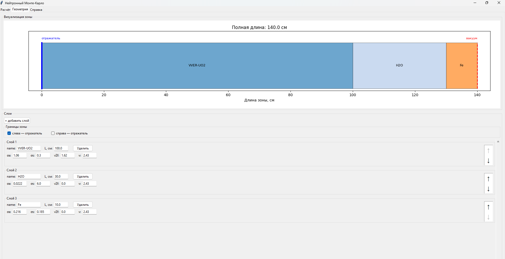

# Моделирование переноса нейтронов методом Монте-Карло

Данный репозиторий содержит программную реализацию и графический интерфейс для лабораторной работы по курсу компьютерного моделирования.

## Цель работы

Основной целью является изучение применения метода Монте-Карло на примере активной зоны ядерного реактора в одномерной геометрии, а также исследование скорости сходимости метода, влияния неактивных батчей и размера пространственной сетки на конечные результаты.

## Описание математической модели

В основе модели лежит имитация переноса нейтронов в одногрупповом приближении. Среда рассматривается как гетерогенная и состоит из набора плоских слоев с постоянными ядерно-физическими свойствами. Приняты следующие физические допущения:
- Перенос нейтронов рассматривается только по одной пространственной координате. Направление движения дискретизировано.
- Используется одногрупповое приближение, при котором энергия нейтронов не моделируется, а макроскопические сечения взаимодействия считаются постоянными для каждого материала.
- Рассеяние считается изотропным в одномерном приближении.
- Деление считается мгновенным, эмиттеры запаздывающих нейтронов отсутствуют.
- На внешних границах расчетной области задаются условия отражения или вакуума, внутри области нейтрон переходит между слоями без изменения направления.

Для оценки эффективного коэффициента размножения используется история поколений с отбрасыванием начальных неактивных батчей для выхода на стационарный режим. Пространственное распределение потока оценивается с помощью трекового оценщика длины пробега.

## Графический интерфейс

Для удобства работы с моделью реализован графический интерфейс на базе библиотеки Tkinter. Запуск осуществляется через командную строку. Интерфейс разделен на три вкладки.

1. Вкладка Расчет предназначена для задания параметров моделирования: количества нейтронов в поколении, общего числа батчей, числа неактивных поколений, количества ячеек пространственной сетки и зерна генератора случайных чисел. Здесь же располагается кнопка запуска расчета, индикатор прогресса и вывод итогового значения коэффициента размножения с оценкой погрешности. После завершения расчета доступна кнопка для построения графиков истории коэффициента размножения и пространственного распределения потока.
2. Вкладка Геометрия представляет собой конструктор активной зоны. В верхней части отображается визуализация расчетной области. Ниже расположены поля для настройки каждого слоя: название, толщина, сечения поглощения и рассеяния, а также произведение выхода на сечение деления. Слои можно добавлять, удалять и менять их порядок. В этой же вкладке задаются граничные условия для левой и правой границ области, которые могут быть отражающими или соответствовать вакууму.
3. Вкладка Справка содержит краткие пояснения по работе с интерфейсом и описание физического смысла параметров.

## Установка и запуск

Для работы программы требуется интерпретатор Python версии 3.10 или выше. Перед запуском необходимо установить зависимости. Рекомендуется использовать виртуальное окружение.

Создание и активация виртуального окружения в Windows:
py -m venv .venv
.\.venv\Scripts\Activate.ps1

Установка необходимых библиотек и самого проекта в режиме редактирования:
py -m pip install -r requirements.txt
py -m pip install -e .

После установки графический интерфейс запускается следующей командой:
py -m neutron_mc.gui

Альтернативный способ запуска после установки пакета:
neutron-mc-gui

Для запуска скрипта проверки модели на аналитических пределах используется команда:
py -m neutron_mc.validation

Для запуска юнит-тестов применяется следующая команда:
py -m pytest -q

## Структура проекта

- src/neutron_mc/model.py содержит реализацию физической модели и алгоритма Монте-Карло.
- src/neutron_mc/gui.py содержит код графического интерфейса.
- src/neutron_mc/validation.py содержит скрипт валидации модели по аналитическим тестам.
- tests/test_model.py содержит базовые тесты для проверки работоспособности кода.
- pyproject.toml и requirements.txt содержат конфигурацию проекта и список зависимостей.
- PDF-отчет по выполненной работе прикреплен в корне репозитория или в папке docs.
